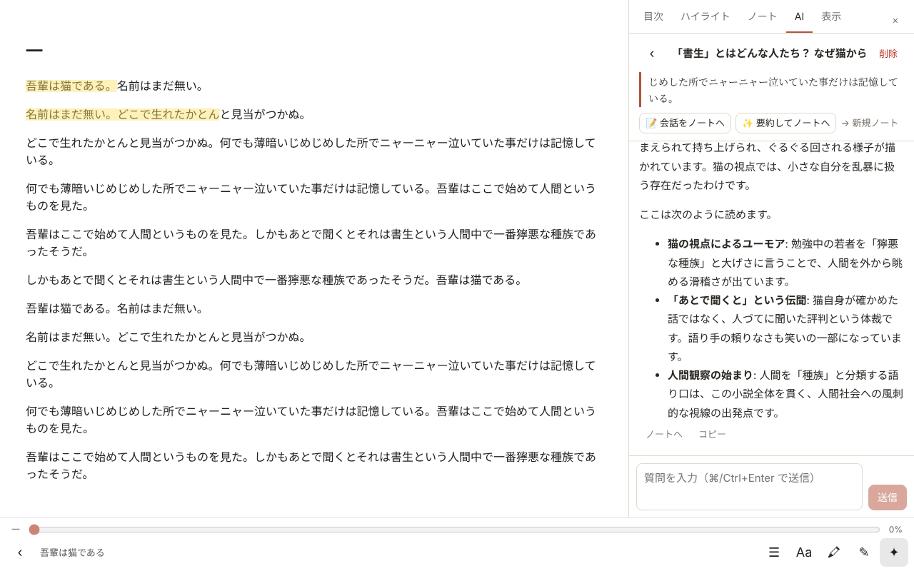
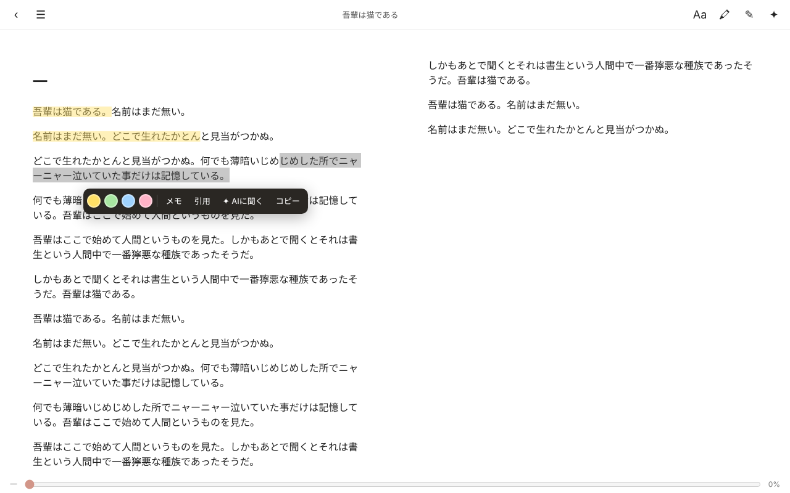
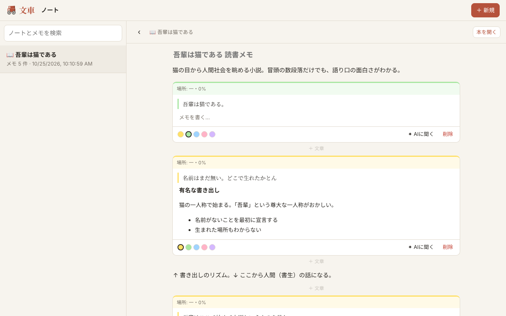
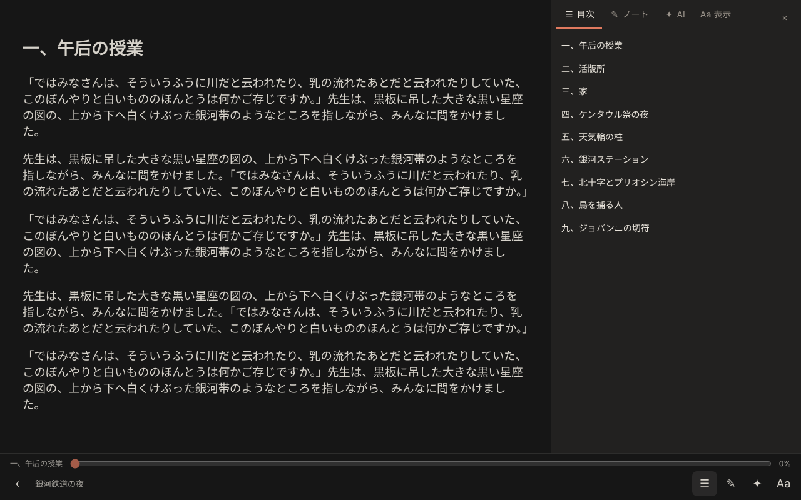
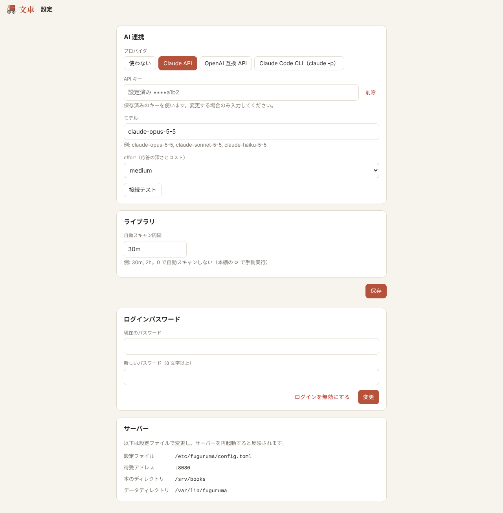
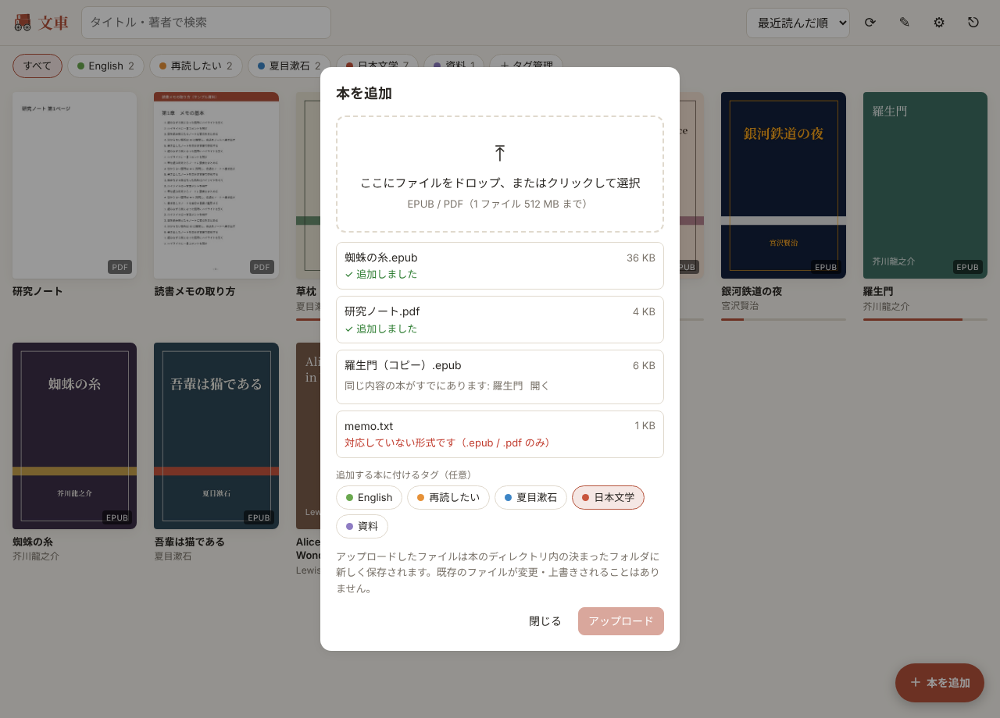
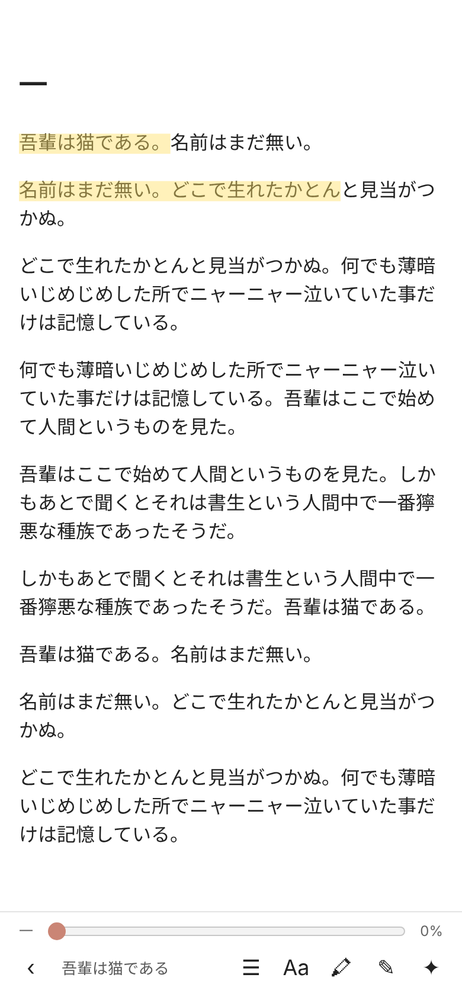
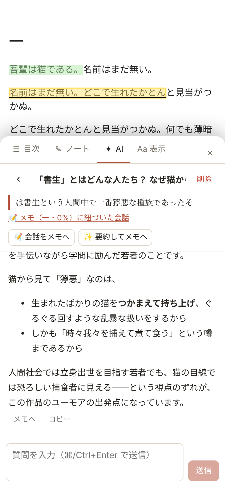

<p align="center">
  
</p>

<h1 align="center">文車 Fuguruma</h1>

<p align="center">
  <a href="https://github.com/kienn-HCl/fuguruma/actions/workflows/ci.yml"></a>
  <a href="LICENSE"></a>
</p>

手持ちの電子書籍（EPUB / PDF）を、スマホ・タブレット・PC のブラウザから同じ UI で読むためのセルフホスト型リーダーです。
読書位置・ハイライト・読書メモ・AI との会話はすべてサーバーに保存され、全端末で同期されます。

本のファイルは**任意のディレクトリ**に置けます（サーバーのローカルディスク、外付けドライブ、NFS / SMB でマウントした共有フォルダなど）。Fuguruma が既存の本のファイルを書き換えたり消したりすることはありません。

- 📚 表紙付きの本棚表示、タグでグルーピング、検索・並び替え
- 📖 EPUB（epub.js）/ PDF（pdf.js、日本語 PDF 対応）リーダー。タップ・スワイプ・キーボードでページ送り
- 🖍 ハイライト（5 色）＋コメント、Markdown の読書ノート
- ✦ 選択した文をもとに AI と会話。会話は本ごとに保存され、ノートへ書き出し／AI 要約してから自分で整形できる
  - AI は **Claude API / OpenAI 互換 API（OpenAI・Gemini・OpenRouter・Ollama・LM Studio など）** から選択。Web の設定画面で切り替え可能
- 🔄 端末間で読書位置を同期（別端末で先に進んでいたら「移動」を提案）
- 📁 本のファイルを移動・リネームしても、内容の指紋で同じ本として追跡（メモが消えない）
- ⤒ ブラウザから本（EPUB / PDF）をアップロード。本のディレクトリ内の決まったフォルダに新しいファイルとして保存（既存ファイルの上書きはしない）

仕様の詳細は [docs/SPEC.md](docs/SPEC.md) を参照してください。

- [スクリーンショット](#スクリーンショット)
- [はじめかた](#はじめかた)
- [systemd で動かす（推奨）](#systemd-で動かす推奨)
- [Docker で動かす（任意）](#docker-で動かす任意)
- [外部からアクセスする場合](#外部からアクセスする場合)
- [設定](#設定)
- [構成と開発](#構成と開発)
- [ライセンス](#ライセンス)

## スクリーンショット

**本棚**：表紙の一覧、タグで絞り込み、読書進捗バー


**リーダー + AI**：選択した文について AI と会話。ハイライトは黄色、会話は本ごとに保存される



| 文を選択したときのメニュー | AI の会話を要約してノートに保存 |
|---|---|
|  |  |

| ダークテーマと目次 | 設定画面（AI プロバイダの切り替え） |
|---|---|
|  |  |

**本のアップロード**：ファイルを選ぶか本棚にドロップ。同じ内容の本は重複として弾かれる



**スマホ**

<p>
  
  
  
</p>

<sub>サンプルの本は著作権の切れた作品の冒頭部分を使って生成したものです。AI の応答は Claude による実際の出力です。</sub>

## はじめかた

実行に必要なのは **バイナリ 1 つと設定ファイル 1 つ** です。Docker は必須ではありません。

### ビルド済みバイナリを使う

[Releases](https://github.com/kienn-HCl/fuguruma/releases) から OS / CPU に合ったアーカイブ（linux / macOS / windows、amd64 / arm64）をダウンロードして展開します。Web UI はバイナリに同梱されています。

```bash
tar xzf fuguruma_<version>_linux_amd64.tar.gz
./fuguruma version
```

### ソースからビルドする

Go 1.26 以上と Node.js 22 以上が必要です（Node.js はビルド時のみ）。

```bash
make build                          # web をビルドし、bin/fuguruma を生成
make build GOOS=linux GOARCH=arm64  # 別アーキテクチャ向けのクロスコンパイル
```

### Nix で使う

```bash
nix run github:kienn-HCl/fuguruma -- -config ./config.toml   # ビルドしてそのまま起動
nix build github:kienn-HCl/fuguruma                          # ./result/bin/fuguruma ができる
```

### とりあえず試す

```bash
./fuguruma -config ./config.toml          # 初回は config.toml が作られる
# config.toml の server.books_dir を本のディレクトリに書き換えて再起動
./fuguruma -config ./config.toml passwd   # ログインパスワードを設定（任意）
```

http://localhost:8080 を開き、⚙（設定）から AI プロバイダを設定します。（ソースからビルドした場合、バイナリは `bin/fuguruma` です）

## systemd で動かす（推奨）

バイナリ + systemd でそのままサーバーとして常駐させられます。以下は Linux での例です。

```bash
# 1. 専用ユーザーとバイナリ
sudo useradd --system --home-dir /var/lib/fuguruma --shell /usr/sbin/nologin fuguruma
sudo install -m 755 fuguruma /usr/local/bin/fuguruma   # ソースからビルドした場合は bin/fuguruma

# 2. 設定ファイル（Web から編集できるよう、ディレクトリごとサービスユーザーの所有にする）
sudo install -d -o fuguruma -g fuguruma -m 750 /etc/fuguruma
sudo install -o fuguruma -g fuguruma -m 600 deploy/config.example.toml /etc/fuguruma/config.toml
sudoedit /etc/fuguruma/config.toml          # server.books_dir などを編集

# 3. ログインパスワード
sudo -u fuguruma /usr/local/bin/fuguruma -config /etc/fuguruma/config.toml passwd

# 4. ユニットを登録して起動（/var/lib/fuguruma は systemd が作成）
sudo install -m 644 deploy/fuguruma.service /etc/systemd/system/fuguruma.service
sudo systemctl daemon-reload
sudo systemctl enable --now fuguruma
```

運用コマンド:

```bash
systemctl status fuguruma          # 状態
journalctl -u fuguruma -f          # ログ
sudo systemctl restart fuguruma    # [server] の設定を変えたら再起動
```

注意点:

- 本のディレクトリは `fuguruma` ユーザーが**読める**必要があります（書き込み権限は不要）。例: `sudo setfacl -R -m u:fuguruma:rX /srv/books`
- ユニットは `ProtectSystem=strict` / `ProtectHome=read-only` で、書き込み可能なのは `/var/lib/fuguruma` と `/etc/fuguruma` だけです。本のディレクトリが `/home` 配下でも読み取りは可能です。
- Web からの本のアップロードを使う場合は、保存先フォルダ（既定では `本のディレクトリ/Uploads`）にだけ書き込みを許可してください。ユニットの `ReadWritePaths=/srv/books/Uploads` のコメントを外してパスを合わせ、フォルダを作って `fuguruma` ユーザーに書き込み権限を付けます（例: `sudo install -d -o fuguruma -g fuguruma /srv/books/Uploads`）。本のディレクトリのそれ以外の部分は読み取り専用のままで構いません。
- 本のディレクトリがネットワークマウント（NFS/SMB）の場合は、ユニットの `RequiresMountsFor=` のコメントを外してパスを書くと、マウント完了後に起動します。
- API キーなどを設定ファイルに書きたくない場合は `/etc/fuguruma/env`（`ANTHROPIC_API_KEY=...` 形式、`chmod 600`）に書けば読み込まれます。

### ユーザー単位で動かす場合（自分の PC など）

```bash
install -D -m 755 fuguruma ~/.local/bin/fuguruma
install -D -m 644 deploy/fuguruma.user.service ~/.config/systemd/user/fuguruma.service
~/.local/bin/fuguruma -config ~/.config/fuguruma/config.toml passwd   # 設定ファイル作成 + パスワード
$EDITOR ~/.config/fuguruma/config.toml                               # books_dir / data_dir を絶対パスで設定
systemctl --user daemon-reload && systemctl --user enable --now fuguruma
journalctl --user -u fuguruma -f
loginctl enable-linger "$USER"     # ログアウト後も動かし続ける場合
```

（ユーザー単位の場合は `data_dir` に例えば `~/.local/share/fuguruma` の絶対パスを指定してください）

## Docker で動かす（任意）

```bash
mkdir -p config data && sudo chown 1000:1000 config data
# docker-compose.yml の /path/to/books を本のディレクトリに書き換える
docker compose up -d --build
```

コンテナ内のパスは環境変数で固定され、設定は `./config/config.toml` に保存されます。Web からの本のアップロードを使う場合は、`docker-compose.yml` のコメントにあるとおり保存先フォルダだけを書き込み可能でマウントしてください。

## 外部からアクセスする場合

ログインパスワードを設定し、Caddy などで HTTPS を終端してください（Tailscale 等の VPN 内だけで使うならパスワードなしでも可）。ログインを無効にすると、アクセスできる人は誰でも設定画面から AI の API キーを差し替えられる点に注意してください。

AI の応答はストリーミング（SSE）なので、nginx を挟む場合は `proxy_buffering off;` を推奨します。

```
# Caddyfile の例
books.example.com {
  reverse_proxy localhost:8080
}
```

## 設定

### 設定ファイルとデータ

| | 場所 | 内容 |
|---|---|---|
| 設定 | `-config` で指定した TOML（既定 `./config.toml`、環境変数 `FUGURUMA_CONFIG` でも指定可） | 待受アドレス、ディレクトリ、ログインパスワード（bcrypt ハッシュ）、AI プロバイダと API キーなど |
| データ | 設定の `server.data_dir` | `fuguruma.db`（SQLite）、`covers/`、セッション署名鍵 |

- 設定ファイルが無ければ起動時に既定値で作成されます。例: [deploy/config.example.toml](deploy/config.example.toml)
- `[library]` `[auth]` `[ai]` は Web の **設定画面（⚙）** から変更でき、即時反映されます（保存時にファイルが書き換わり、コメントは消えます）。
- `[server]`（待受アドレス・本のディレクトリ・データディレクトリ）は、セキュリティのため**設定ファイルでのみ**変更できます。変更後は再起動してください。
- API キーを含むため、設定ファイルはパーミッション `0600` で保存されます。
- 環境変数 `FUGURUMA_ADDR` / `FUGURUMA_DATA_DIR` / `FUGURUMA_BOOKS_DIR` / `FUGURUMA_PASSWORD` / `ANTHROPIC_API_KEY` / `OPENAI_API_KEY` は設定ファイルの値を上書きします（ファイルには書き戻されません。主にコンテナ向け）。
- バックアップは `data_dir` と設定ファイルをコピーすれば十分です（本のファイル自体は各自のバックアップで）。

### 本のアップロード

本棚右下の「＋ 本を追加」ボタン、または本棚へのファイルのドロップで EPUB / PDF を追加できます。

- 保存先は `server.books_dir` の中の `library.upload_dir`（既定 `Uploads`）です。設定画面から変更・無効化できます。
- 同じ名前のファイルがあれば `名前 (2).pdf` のように別名で保存し、既存のファイルは決して上書きしません。
- 内容がまったく同じ本がすでにあれば、重複としてアップロードを断ります。ファイルが見つからなくなっていた本と同じ内容なら、その本に付け直すのでメモやハイライトが戻ります。
- 拡張子と中身（PDF ヘッダー / EPUB の構造）を確認し、1 ファイルの上限（`library.upload_max_mb`、既定 512 MB）を超えるものは受け付けません。
- 書き込み権限がない（読み取り専用でマウントしている）場合はエラーになります。systemd・Docker での設定は各節を参照してください。

### 本のファイルが消えたとき

Fuguruma は本のファイルを削除しません（アップロードしたものも含みます）。ファイルの整理は本のディレクトリ側で行ってください。

- ファイルが見つからなくなった本は「見つからない本」になり、本棚には表示されなくなります。タグ列の「見つからない本」チップから一覧を確認できます。
- メモ・ハイライト・AI との会話・読書位置は残っています。ファイルを本のディレクトリに戻す（場所や名前は変わっていても構いません）か、同じファイルをアップロードし直すと元に戻ります。
- 不要な本は、その本の「⋯」から**本棚から削除**できます（ファイルが見つからない本に限ります）。ハイライト・AI との会話・読書位置・タグ付けは削除され、ノートは本に紐づかないノートとして残ります。
- 本のディレクトリ自体が読めないときや、空になっているとき（ネットワークドライブのマウントが外れているなど）は、スキャンを中止して本の状態を変えません。全部の本が「見つからない本」になってしまうのを防ぐためです。本当にすべての本を消した場合は、そのままでは見つからない本として扱われない点に注意してください。

### AI プロバイダ

| provider | 説明 |
|---|---|
| `anthropic` | Claude API（公式 Go SDK）。安全分類器で拒否された場合に推奨モデルへ自動で再試行するサーバー側フォールバック（`fallbacks: "default"`）を有効にしています |
| `openai` | OpenAI 互換の Chat Completions API。`base_url` を変えれば OpenAI / Gemini / OpenRouter / Ollama / LM Studio / vLLM などに接続できます |
| `none` | AI 機能を無効化 |

設定画面の「接続テスト」で、保存前に疎通を確認できます。

## 構成と開発

### 技術構成

| | |
|---|---|
| バックエンド | Go（標準 `net/http`）+ SQLite（`modernc.org/sqlite`、CGO 不要） |
| フロントエンド | TypeScript + React + Vite（ビルド結果を Go バイナリに `embed`） |
| 設定 | TOML の設定ファイル（Web の設定画面からも編集可） |
| データ | `data_dir` 配下の SQLite（本のメタデータ・タグ・進捗・ハイライト・ノート・AI 会話）と表紙キャッシュ |

### 開発

[Nix](https://nixos.org/) があれば `nix develop` で開発に必要なツール一式（Go、Node.js、gopls、goimports、govulncheck、GoReleaser、make）が入ったシェルに入れます。Nix を使わない場合は Go 1.26 以上と Node.js 22 以上を各自で用意してください。

```bash
nix develop    # 開発用シェルに入る（以降のコマンドはこの中で）
make dev-api   # API サーバー（config.toml を使用、:8080）
make dev-web   # Vite 開発サーバー（:5173、/api は :8080 へプロキシ）
make test      # go test
make lint      # gofmt / go vet / TypeScript の型チェック
make notices   # 依存ライブラリを変えたら THIRD_PARTY_NOTICES.md を再生成
```

- **CI**（`.github/workflows/ci.yml`）：プッシュとプルリクエストごとに、Web UI のビルド、gofmt、go vet、go test、起動確認、THIRD_PARTY_NOTICES.md が最新か、govulncheck を実行します。
- **リリース**（`.github/workflows/release.yml`）：`v0.1.0` のようなタグを push すると、GoReleaser が各 OS 向けのバイナリをビルドして GitHub Releases に公開します。
- **Nix**：`nix build` で Web UI 込みのバイナリを、`nix flake check` で同じビルドを確認できます。CI でも実行しています。Go の依存（`go.mod` / `go.sum`）を変えたら、`flake.nix` の `vendorHash` を `lib.fakeHash` にして `nix build` し、エラーに出たハッシュに置き換えてください（npm 側は `package-lock.json` から自動で取得するので更新不要です）。
- **依存関係の更新**：Dependabot（`.github/dependabot.yml`）が Go・npm・GitHub Actions の更新を毎週提案します。

```
cmd/fuguruma      エントリポイント（serve / passwd / version）
internal/config   設定ファイルの読み込み・検証・保存、環境変数による上書き
internal/db       SQLite スキーマ（マイグレーション）とクエリ
internal/library  ディレクトリスキャン、EPUB メタデータ・表紙抽出、移動検知
internal/auth     パスワード（bcrypt）+ 署名付き Cookie
internal/ai       AI プロバイダ（Claude API / OpenAI 互換）、プロンプト
internal/api      REST / SSE ハンドラ、設定 API、SPA 配信
web/src/pages     本棚・リーダー・ノート・設定・ログイン
web/src/reader    EpubView / PdfView（共通インターフェース ReaderHandle）
deploy/           systemd ユニット、設定ファイル例
scripts/          THIRD_PARTY_NOTICES.md の生成スクリプト
docs/             仕様書（SPEC.md）、スクリーンショット、ロゴ
```

DB スキーマを変更するときは `internal/db/db.go` の `migrations` に要素を **追加** してください（`PRAGMA user_version` で適用済みを管理）。

## 既知の制限 / 今後

- 表示設定（テーマ・文字サイズ・本文フォント）は端末ごと
- オフライン読書（PWA）、CBZ、縦書き最適化、本全体を対象にした AI 質問は未対応（SPEC.md §10）
- PDF は 1 ページ表示。ハイライトは選択範囲の矩形で保存するため、ズーム倍率が変わっても位置は保たれます

## ライセンス

[MIT License](LICENSE)。バイナリに同梱している依存ライブラリ（epub.js、pdf.js、React など）のライセンスは [THIRD_PARTY_NOTICES.md](THIRD_PARTY_NOTICES.md) にまとめています。

脆弱性を見つけた場合は [SECURITY.md](SECURITY.md) を参照してください。
